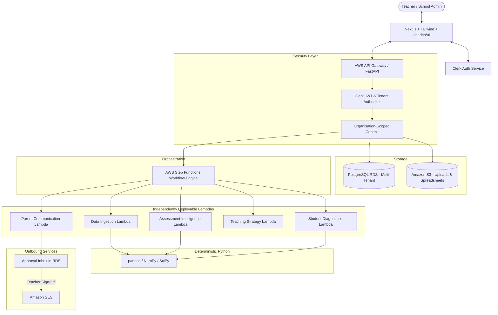

# TeachSmarter: System Architecture

## 1. Overview

TeachSmarter is designed as a serverless, event-driven, multi-agent platform hosted on AWS, serving individual teachers and primary/secondary schools. The architecture balances automated AI capabilities with strict Human-in-the-Loop (HITL) safeguards.

## 2. Component Design

### 2.1 Frontend
- **Framework**: Next.js 15 (App Router), TypeScript.
- **Styling & Components**: Tailwind CSS, shadcn/ui, Lucide Icons.
- **Charts & Visualizations**: Recharts for psychometric curves, score distributions, and longitudinal trends.
- **Authentication**: Clerk Next.js SDK (`@clerk/nextjs`) managing user logins, session tokens, and organisation switching.
- **State & Form Validation**: React Hook Form, Zod.

### 2.2 Backend API & Security
- **Framework**: FastAPI (Python 3.11+).
- **ORM & Data Layer**: SQLAlchemy 2.0 (async), Alembic for schema migrations.
- **Clerk Auth Middleware**: Validates incoming Clerk JWT bearer tokens, resolves `org_id`, and injects strict tenant isolation filters into every database query.
- **No Unrestricted Access**: Agents and API handlers operate strictly within the caller's authorized organisation ID.

### 2.3 Deterministic Analytics Core (`backend/app/analytics`)
- Pure Python calculation modules:
  - `difficulty.py`: Item difficulty ($p = R/N$).
  - `discrimination.py`: Kelley's upper/lower 27% index ($D = p_U - p_L$).
  - `correlation.py`: Point-biserial correlation ($r_{pbis}$).
  - `distractors.py`: Distractor selection proportions and breakdown by ability quartile.
  - `trajectories.py`: Historical score rolling average, standard deviation, momentum ($\Delta$), and minimum sample size guards.
- **Rule**: Never delegate statistical math to an LLM.

### 2.4 Agent Architecture (AWS Lambda + Step Functions)
- Each agent is an independent AWS Lambda function with its own dependencies and Pydantic-validated input/output schema.
- **AWS Step Functions**: The authoritative state machine managing execution sequence, retries, conditional branches, error compensation, and pauses for human approval.
- An optional coordinator Lambda may prepare inputs or route tasks, but Step Functions holds all authoritative workflow state.

### 2.5 Outbound Communication Safety
- Parent Communication Lambda generates drafts with status `PENDING`.
- No Lambda possesses direct permission to invoke Amazon SES.
- Amazon SES can only be invoked by an authorized teacher endpoint upon explicit verification that:
  1. The draft status is `PENDING` or `EDITED`.
  2. The teacher possesses verified organisation permissions.
  3. The content hash matches the approved version.
  4. In demo mode, live email sending is strictly disabled (mocked/sandboxed).

